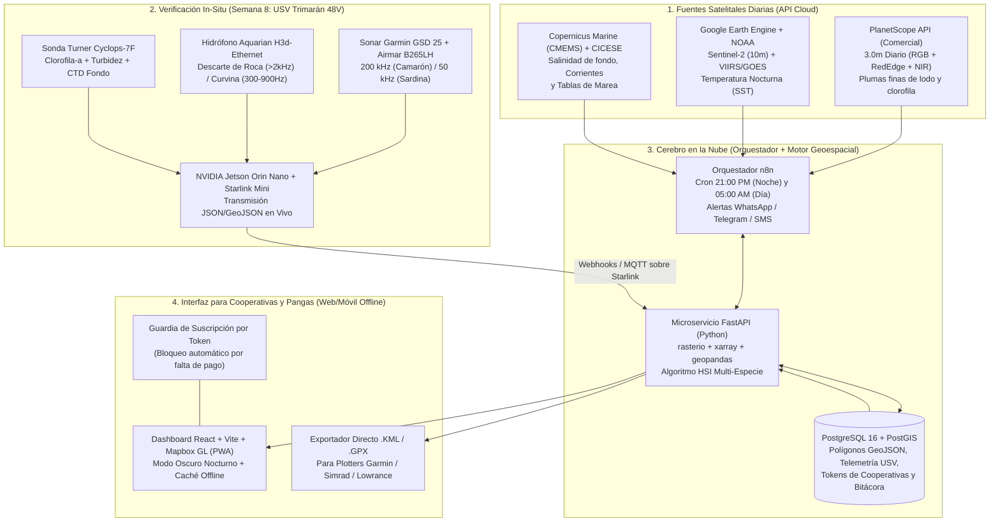

# PLAN DE PROGRAMACIÓN Y ARQUITECTURA DE LA PLATAFORMA WEB GIS SATELITAL (HITO DÍA 21)

**Objetivo del Entregable (Semana 3 / Día 21):** Poner en producción el sistema automatizado que ingesta diariamente las imágenes satelitales comerciales de **PlanetScope (3.0 m de resolución diaria)** junto con **Sentinel-2 (10 m)**, **NOAA VIIRS/GOES (SST nocturna)** y **Copernicus CMEMS (Salinidad/Corrientes de fondo)**, calcula los polígonos óptimos para **Turno Nocturno (Camarón)** y **Turno Diurno (Sardina/Escama)**, y envía a las **10:00 PM** un enlace interactivo protegido por token a los celulares de las cooperativas y capitanes de panga.

---

## 1. Arquitectura del Sistema Cloud + Edge (USV)



---

## 2. Cómo Activar el Periodo de Prueba (Trial) de PlanetScope y Fuentes de Alta Precisión para la Demo Real (Semana 1)

Para demostrar el sistema a los socios y mandar a las primeras pangas a verificar **desde antes de pagar la anualidad/semestre comercial**, sigue esta ruta exacta de activación:

1. **PlanetScope (3.0 metros diarios — Planet Labs):**
   - **Cuenta de Evaluación Comercial (14–30 días):** Solicitar en [planet.com/contact-sales](https://www.planet.com/contact-sales/) o vía el portal de desarrolladores de **Sentinel Hub (Planet Sandbox / Evaluation Account)** un *Evaluation AOI* sobre el polígono de **Topolobampo–Ohuira–Santa María** ($\text{BBOX}: [-109.25, 25.45, -108.90, 25.80]$) o **Bahía de Kino** ($\text{BBOX}: [-112.05, 28.70, -111.85, 28.95]$).
   - Con la llave `PLANET_API_KEY`, el script en Python descarga automáticamente el activo `ortho_analytic_8b_sr` (Reflectancia de Superficie de 8 bandas a 3 metros corregida atmosféricamente).
2. **Copernicus Marine Service (CMEMS — Modelos Físicos de Fondo y Clorofila):**
   - Crear cuenta gratuita instantánea en [data.marine.copernicus.eu](https://data.marine.copernicus.eu).
   - Usar la librería oficial `copernicusmarine` en Python para descargar diariamente:
     - `GLOBAL_ANALYSISFORECAST_PHY_001_024`: Temperatura potencial en el fondo marino (`bottomT`), salinidad (`so`) y vectores de corriente (`uo`, `vo`).
     - `GLOBAL_ANALYSISFORECAST_BGC_001_028`: Clorofila-a (`chl`) y oxígeno disuelto en fondo.
3. **Google Earth Engine (Sentinel-2 L2A 10m + NOAA VIIRS SST 750m):**
   - Activar proyecto en [code.earthengine.google.com](https://code.earthengine.google.com) y exportar llave JSON de cuenta de servicio (`service-account.json`) para el contenedor de FastAPI.

---

## 3. Esquema de Base de Datos Espacial (`PostgreSQL 16 + PostGIS`)

Archivo SQL inicial (`init_postgis.sql`) para almacenar cooperativas, tokens de acceso, polígonos satelitales diarios, confirmaciones acústicas del USV y retroalimentación de captura de las pangas:

```sql
CREATE EXTENSION IF NOT EXISTS postgis;
CREATE EXTENSION IF NOT EXISTS "uuid-ossp";

-- 1. Tabla de Clientes / Cooperativas y Control de Suscripción (Tokens)
CREATE TABLE cooperativas (
    id UUID PRIMARY KEY DEFAULT uuid_generate_v4(),
    nombre VARCHAR(120) NOT NULL,
    zona_operacion VARCHAR(80) NOT NULL, -- ej. 'Topolobampo-Ohuira', 'Bahia de Kino'
    especie_contratada VARCHAR(50) NOT NULL DEFAULT 'MULTI', -- 'CAMARON', 'SARDINA', 'MULTI'
    access_token VARCHAR(64) UNIQUE NOT NULL,
    suscripcion_activa BOOLEAN DEFAULT TRUE,
    fecha_vencimiento TIMESTAMP WITH TIME ZONE NOT NULL,
    telefono_alerta_whatsapp VARCHAR(30),
    created_at TIMESTAMP WITH TIME ZONE DEFAULT NOW()
);

-- 2. Tabla de Corridas Satelitales Diarias (Día 21 en adelante)
CREATE TABLE boletines_satelitales (
    id UUID PRIMARY KEY DEFAULT uuid_generate_v4(),
    fecha_operacion DATE NOT NULL,
    turno VARCHAR(20) NOT NULL, -- 'NOCTURNO_CAMARON' (22:00h) o 'DIURNO_SARDINA' (05:00h)
    fuente_optica VARCHAR(50) NOT NULL, -- 'PlanetScope_3m', 'Sentinel2_10m'
    porcentaje_nubes NUMERIC(5,2),
    fase_lunar VARCHAR(40),
    velocidad_marea_nudos NUMERIC(4,2),
    kml_url TEXT,
    created_at TIMESTAMP WITH TIME ZONE DEFAULT NOW()
);

-- 3. Tabla de Polígonos de Probabilidad (Zonas Calientes GeoJSON / PostGIS)
CREATE TABLE poligonos_pesca (
    id UUID PRIMARY KEY DEFAULT uuid_generate_v4(),
    boletin_id UUID REFERENCES boletines_satelitales(id) ON DELETE CASCADE,
    especie_objetivo VARCHAR(40) NOT NULL, -- 'Camaron Azul/Cafe', 'Sardina Monterrey', 'Curvina'
    prioridad INT NOT NULL, -- 1 (Rojo: >80%), 2 (Amarillo: 60-80%), 3 (Verde: Exploración)
    score_hsi NUMERIC(5,2) NOT NULL, -- Índice de Hábitat 0 a 100
    sst_centigrados NUMERIC(4,2),
    turbidez_ndti NUMERIC(5,3),
    clorofila_mg_m3 NUMERIC(6,3),
    profundidad_brazas_min NUMERIC(4,1),
    profundidad_brazas_max NUMERIC(4,1),
    confirmado_por_usv BOOLEAN DEFAULT FALSE, -- Cambia a TRUE cuando el USV pasa por encima
    riesgo_roca_hidrofono BOOLEAN DEFAULT FALSE, -- TRUE si el hidrófono detectó >2 kHz (rompe-redes)
    geom GEOMETRY(Polygon, 4326) NOT NULL,
    centroide GEOMETRY(Point, 4326) NOT NULL
);

CREATE INDEX idx_poligonos_geom ON poligonos_pesca USING GIST (geom);

-- 4. Tabla de Telemetría y Verificación en Vivo del USV Trimarán (Semana 8)
CREATE TABLE telemetria_usv (
    id BIGSERIAL PRIMARY KEY,
    timestamp_utc TIMESTAMP WITH TIME ZONE DEFAULT NOW(),
    modo_propulsion VARCHAR(20), -- 'HIBRIDO_TRANSITO', 'ELECTRICO_STEALTH', 'LIMP_HOME'
    voltaje_bateria_v NUMERIC(5,2), -- Nominal 48V (51.2V LiFePO4)
    soc_bateria_pct NUMERIC(5,2),
    rumbo_rtk_grados NUMERIC(5,2), -- Moving Baseline Dual F9P (0.1 deg)
    frecuencia_sonar_khz INT, -- 200 (Camarón) o 50 (Sardina)
    densidad_biomasa_sonar NUMERIC(6,2),
    ruido_fondo_db NUMERIC(5,2),
    tipo_fondo_acustico VARCHAR(30), -- 'LODO_ORGANICO', 'ARENA', 'ROCA_PELIGRO'
    clorofila_insitu_ug_l NUMERIC(6,2),
    temp_fondo_c NUMERIC(4,2),
    salinidad_psu NUMERIC(4,2),
    geom GEOMETRY(Point, 4326) NOT NULL
);

-- 5. Bitácora de Retroalimentación de Capitanes (Entrenamiento del Modelo)
CREATE TABLE capturas_reportadas (
    id UUID PRIMARY KEY DEFAULT uuid_generate_v4(),
    cooperativa_id UUID REFERENCES cooperativas(id),
    poligono_id UUID REFERENCES poligonos_pesca(id),
    kilos_capturados NUMERIC(7,2),
    talla_promedio VARCHAR(30),
    comentario_capitan TEXT,
    geom_lance GEOMETRY(Point, 4326),
    created_at TIMESTAMP WITH TIME ZONE DEFAULT NOW()
);
```

---

## 4. Fórmulas Matemáticas del Motor de Fusión (`FastAPI` Python)

El microservicio en Python procesa los rásters de 3 metros de PlanetScope junto con las capas oceanográficas y calcula dos índices independientes según el turno:

### 4.1 Algoritmo Turno Nocturno: Camarón ($\text{HSI}_{\text{Camarón}}$ — Ejecución 21:30 hrs)
1. **Índice de Turbidez Diferencial Normalizado ($\text{NDTI}$ a 3 m de resolución):**
   $$\text{NDTI} = \frac{B_{\text{Rojo}} - B_{\text{Verde}}}{B_{\text{Rojo}} + B_{\text{Verde}}}$$
   - Se buscan los **bordes de gradiente** ($0.05 \le \text{NDTI} \le 0.22$) donde el reflujo de marea resuspende detrito orgánico sin llegar a ahogar las branquias por exceso de lodo.
2. **Ventana Termohalina de Fondo y Batimetría:**
   - Temperatura óptima de actividad nocturna: $24.0^\circ\text{C} \le T_{\text{fondo}} \le 28.5^\circ\text{C}$.
   - Salinidad óptima: $28\text{ a }36\text{ PSU}$.
   - Máscara batimétrica estricta: **2 a 12 brazas ($3.5\text{ a }22\text{ m}$)** en interior de bahía y boca.
3. **Ecuación de Calificación del Polígono (0 a 100 puntos):**
   $$\text{HSI}_{\text{Camarón}} = 0.35 \cdot S_{\text{Turbidez (3m)}} + 0.25 \cdot S_{\text{TempFondo}} + 0.20 \cdot S_{\text{Batimetría}} + 0.20 \cdot S_{\text{Marea/Luna}}$$

### 4.2 Algoritmo Turno Diurno: Sardina, Curvina y Aguamala ($\text{HSI}_{\text{Sardina}}$ — Ejecución 05:00 hrs)
1. **Índice de Clorofila-a RedEdge ($\text{NDCI}$ a 3 m de PlanetScope + Sonda Turner Cyclops-7F):**
   $$\text{NDCI} = \frac{B_{\text{RedEdge (705 nm)}} - B_{\text{Rojo (665 nm)}}}{B_{\text{RedEdge (705 nm)}} + B_{\text{Rojo (665 nm)}}}$$
2. **Detección de Frentes Térmicos de Surgencia (Algoritmo Canny/Sobel sobre SST):**
   - La sardina Monterrey y la curvina se concentran exactamente en la línea de choque entre el agua fría rica en nutrientes ($17^\circ\text{C}\text{--}21^\circ\text{C}$, alta Clorofila-a $>2.5\text{ mg/m}^3$) y el agua cálida costera, en profundidades de **15 a 150 metros**.

---

## 5. Cronograma de Programación de los 21 Días (Paso a Paso)

| Días | Módulo a Programar | Entregable Técnico Verificable |
| :--- | :--- | :--- |
| **Días 1 a 4** | **Infraestructura Docker + PostGIS + Ingesta PlanetScope/GEE** | `docker-compose.yml` corriendo PostgreSQL/PostGIS, FastAPI y n8n. Script `ingest_planet_gee.py` descargando recortes reales de 3 metros de Topolobampo/Kino. |
| **Días 5 a 9** | **Motor HSI Multi-Especie (Camarón Noche + Sardina Día)** | Endpoint `POST /api/v1/generate-polygons` que transforma el ráster satelital en los 3 mejores polígonos vectoriales (`GeoJSON` y `.KML`) con coordenadas en grados/minutos y profundidad en brazas. |
| **Días 10 a 14** | **Orquestación en n8n y Alertas Automáticas (10:00 PM)** | Flujo de n8n que ejecuta el cálculo a las 21:30 hrs, guarda en PostGIS y dispara a las 22:00 hrs el mensaje automático a WhatsApp/Telegram de cada cooperativa con su link único. |
| **Días 15 a 18** | **Aplicación Web Progresiva (PWA React + Mapbox Offline)** | Pantalla oscura para celular con GPS del panguero en vivo sobre los polígonos rojos/amarillos, botón *"Descargar a Garmin/Simrad (.GPX/.KML)"*, modo sin señal en altamar y bloqueo por Token. |
| **Días 19 a 21** | **Pruebas en Vivo con Pangas y Cierre del Hito 1** | Demostración real en el muelle con los socios: recepción del mapa a las 10:00 PM y salida de las primeras pangas a verificar los puntos satelitales. **(Cobro del Hito 1: \$4,800 USD).** |

---

## 6. Estructura de Carpetas del Código que Crearemos en el Repositorio

Cuando me indiques que arranquemos la codificación de la Fase 1, crearemos la carpeta `/Users/topete/Desktop/catamaran/plataforma_web_gis/` con la siguiente arquitectura limpia:

```text
/Users/topete/Desktop/catamaran/plataforma_web_gis/
├── docker-compose.yml              # Levanta PostGIS, FastAPI, n8n y Frontend React
├── .env.example                    # Variables para PLANET_API_KEY, GEE_KEY, CMEMS y MAPBOX_TOKEN
├── db/
│   └── init_postgis.sql            # Esquema espacial completo (Cooperativas, Polígonos, Telemetría USV)
├── backend/
│   ├── main.py                     # API FastAPI (Validación de Tokens, GeoJSON, KML, Webhook Starlink USV)
│   ├── engine_hsi.py               # Algoritmo matemático Turno Noche (Camarón) y Turno Día (Sardina/Clorofila)
│   └── satellite_connectors.py     # Clientes API para PlanetScope 3m, Sentinel-2 GEE y Copernicus CMEMS
├── n8n_workflows/
│   └── flujo_diario_10pm_y_5am.json # Flujo listo para importar en n8n
└── frontend/
    ├── index.html                  # PWA Mobile-First Modo Oscuro para Pangueros
    └── src/
        ├── App.jsx                 # Selector Turno Noche (Camarón) / Turno Día (Sardina) + Telemetría USV
        └── MapView.jsx             # Mapa interactivo con caché offline, brazas y alerta de roca por hidrófono
```
