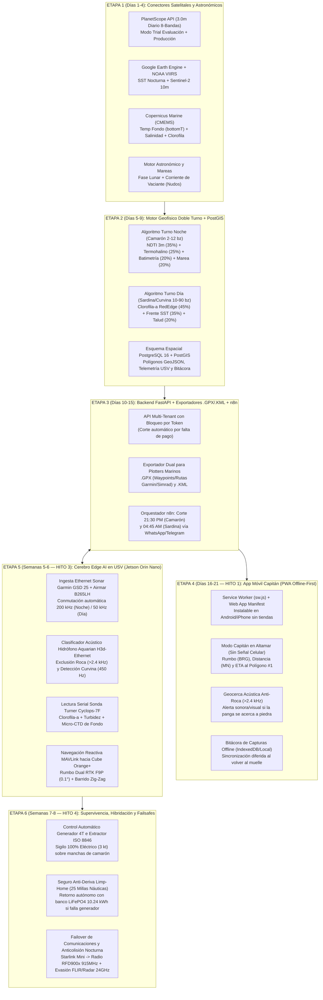

# 12. Plan Maestro de Programación Etapa por Etapa (Arquitectura Full-Stack: Cloud Satelital 3m + App Panga Offline + Cerebro Edge USV 48V)

Este documento define la hoja de ruta de ingeniería de software dividida en **6 Etapas Modulares**, abarcando desde el servidor geoespacial en la nube (**Hito 1 — Día 21**) y la **App Móvil Progresiva (PWA Offline)** para los capitanes de panga/barcos sardineros, hasta el software embebido en la **NVIDIA Jetson Orin Nano + CubePilot Cube Orange+** a bordo del **USV Trimarán Híbrido de 48V "Stealth"** (**Hitos 3 y 4 — Semanas 6 a 8**).

---

## Mapa General de las 6 Etapas de Programación

---

## Desglose Técnico Etapa por Etapa

### Etapa 1: Conectores Satelitales de Alta Precisión y Dinámica de Mareas (Días 1 a 4)
* **Archivos:** `backend/satellite_connectors.py` y `backend/tide_and_moon.py`.
* **Funciones Clave:**
  1. **Conector `PlanetScope3mConnector`:** Consulta el catálogo `PSScene` de Planet Labs sobre los polígonos de Topolobampo–Ohuira–Santa María y Bahía de Kino, descargando el activo `ortho_analytic_8b_sr` (8 bandas a **3.0 metros de resolución diaria**). Soporta tanto la llave de evaluación (*Commercial Trial 14–30 días*) como la suscripción semestral de \$600 USD/mes.
  2. **Conector `CMEMS & GEE`:** Extrae temperatura potencial de fondo (`bottomT`), salinidad (`so`), clorofila regional (`chl`) y temperatura superficial nocturna (`VIIRS SST`).
  3. **Módulo Astronómico y de Mareas (`tide_and_moon.py`):** Calcula la iluminación y fase lunar exacta (luna nueva/llena = mareas vivas de máxima actividad camaronera) y estima la velocidad de vaciante (reflujo en nudos) en las bocas de Topolobampo y Estero La Cruz.

### Etapa 2: Motor Matemático Multi-Especie Doble Turno y Base Espacial PostGIS (Días 5 a 9)
* **Archivos:** `backend/engine_hsi.py` y `db/init_postgis.sql`.
* **Funciones Clave:**
  1. **Cálculo Nocturno ($\text{HSI}_{\text{Camarón}}$):** Evalúa píxel a píxel el gradiente de turbidez fina a 3 m ($\text{NDTI} \in [0.06, 0.22]$), la ventana térmica de fondo ($24.0^\circ\text{C}\text{--}28.5^\circ\text{C}$), la salinidad ($28\text{--}36\text{ PSU}$), la batimetría somera ($2\text{ a }12\text{ brazas}$) y la corriente de reflujo.
  2. **Cálculo Diurno ($\text{HSI}_{\text{Sardina/Escama}}$):** Evalúa el índice RedEdge de Clorofila-a ($\text{NDCI} > 2.5\text{ mg/m}^3$), los frentes térmicos de surgencia ($17.5^\circ\text{C}\text{--}22.5^\circ\text{C}$) y batimetría exterior ($10\text{ a }90\text{ brazas}$) para rentar coordenadas de día a barcos sardineros y escameros.
  3. **Filtro Acústico Anti-Roca:** Penaliza automáticamente cualquier polígono donde el hidrófono del USV haya registrado firma acústica de arrecife/laja ($>2.4\text{ kHz}$), marcándolo como **Zona de Exclusión Rompe-Redes**.

### Etapa 3: API Backend Multi-Tenant, Exportador `.GPX`/`.KML` y Orquestación `n8n` (Días 10 a 15)
* **Archivos:** `backend/main.py`, `backend/gpx_kml_exporter.py` y `n8n_workflows/flujo_diario_10pm_y_5am.json`.
* **Funciones Clave:**
  1. **Control de Suscripciones por Token:** Valida en cada petición si el token de la cooperativa o barco sardinero está vigente; si presenta adeudo, bloquea la descarga de polígonos y telemetría.
  2. **Exportador Dual `.GPX` + `.KML` (`gpx_kml_exporter.py`):** Genera tanto polígonos `.KML` para celulares/tablets como archivos estándar **`.GPX` (con `<wpt>` de los centroides prioritarios y `<rte>` del canal navegable seguro)** para insertarse por tarjeta SD o Wi-Fi directo en plotters **Garmin, Simrad, Lowrance, Furuno y Raymarine**.

### Etapa 4: Aplicación Móvil Progresiva Offline-First para Capitanes (Días 16 a 21 — Hito 1)
* **Archivos:** `frontend/index.html`, `frontend/manifest.webmanifest` y `frontend/sw.js`.
* **Funciones Clave:**
  1. **Instalación Nativa (`PWA`) y Caché en Altamar (`sw.js`):** Guarda en el teléfono la interfaz, los polígonos de las 10:00 PM y la ruta segura del canal antes de salir del muelle.
  2. **Vista Táctica "Modo Capitán / Panga":**
     - Muestra con números gigantes de alto contraste nocturno el **Rumbo (`BRG` en grados)**, la **Distancia (`MN` millas náuticas)** y el **Tiempo Estimado (`ETA`)** desde el GPS de la panga hasta el Polígono Confirmado #1.
     - **Alarma de Geocerca Anti-Roca:** Si el GPS del capitán se acerca a una zona marcada como piedra por el hidrófono del USV, emite una alerta visual y acústica inmediata (*"¡PELIGRO DE ENGANCHE A 0.2 MN!"*).
     - **Bitácora Offline con Cola de Sincronización:** Guarda los reportes de captura en `localStorage` cuando no hay señal en altamar y los sube al servidor en cuanto detecta conexión.

### Etapa 5 y Etapa 6: Controlador de Misión Edge AI y Failsafes del USV Trimarán 48V (Semanas 5 a 8)
* **Archivo:** `usv_edge_jetson/usv_mission_controller.py`.
* **Funciones Clave:**
  1. **Máquina de Estados de Propulsión Híbrida 48V:**
     - **Modo Tránsito Rápido (10.5 nudos):** Activa el pre-barrido de vapores de sentina por 90 segundos (**extractor ISO 8846**), arranca el generador 4T y alimenta los **2x motores Flipsky 65161 de 3.0 kW**.
     - **Modo Sigilo Eléctrico Camaronero (3.0 nudos):** Al entrar al polígono satelital nocturno, apaga el generador 4T para lograr **cero firma acústica submarina** y no espantar al camarón.
  2. **Seguro Anti-Deriva (*Limp-Home* de 25 Millas Náuticas):** Monitorea mediante el **Victron SmartShunt 500A** el estado de carga del banco **LiFePO4 48V 200Ah (10.24 kWh)**. Si el generador 4T falla en mar abierto o el SoC baja al umbral de reserva de retorno, aborta el barrido y regresa autónomamente al muelle a 4.5 nudos.
  3. **Navegación Reactiva MAVLink + Dual RTK F9P ($0.1^\circ$):** Lee el rumbo verdadero desde los **2x u-blox ZED-F9P** (inmune al magnetismo de los cables de 125A) y ordena un patrón de barrido en zig-zag cerrado cuando el sonar CHIRP y la sonda Turner detectan biomasa.
