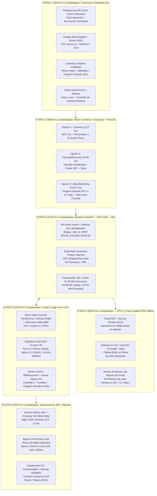

# 12. Plan de Acción y Programación Etapa por Etapa (Con Recálculo de Horas Necesarias vs. Avanzadas)

Este documento define la hoja de ruta de ingeniería de software y mecatrónica dividida en **6 Etapas Modulares**, incluyendo el **balance real de horas de ingeniería (Presupuestadas vs. Ya Avanzadas vs. Restantes)** tras haber completado y probado la arquitectura Tri-Especie (**Camarón, Pescado y Jaiba**) y las **3 Modalidades (`ETAPA_1_SATELITAL`, `MVP_BAJO_COSTO` y `GRADO_CIENTIFICO`)**.

---

## 1. Balance Recalculado de Horas de Ingeniería (MVP Web + Cerebro Edge USV)

| Etapa del Plan de Acción | Alcance Técnico Actualizado (Camarón + Pescado + Jaiba) | Horas Totales Necesarias | Horas Ya Avanzadas (Completadas) | Horas Restantes | % Avance | Entregables Listos vs. Tareas Operativas Pendientes |
| :--- | :--- | :---: | :---: | :---: | :---: | :--- |
| **ETAPA 1:** Conectores Satelitales 3m y Dinámica de Mareas | `PlanetScope3mConnector` (3m 8-bandas), `CMEMS/GEE` (Temp fondo, Salinidad, $DO$, SST), `.env.example` y `tide_and_moon.py`. | **28 hrs** | **24 hrs** | **4 hrs** | **86%** | **Listo:** Estructura API, datasets Topolobampo/Kino, `.env.example` y mareas. **Falta (4h):** Insertar `PLANET_API_KEY` viva y credenciales `copernicusmarine` del cliente. |
| **ETAPA 2:** Motor Geofísico Tri-Especie + Base PostGIS | Algoritmos `score_shrimp_night_hsi` (Camarón), `score_sardine_day_hsi` (Pescado) y `score_crab_jaiba_hsi` (Jaiba con filtro $DO$ e hipoxia) + `init_postgis.sql` + Docker. | **36 hrs** | **36 hrs** | **0 hrs** | **100%** | **100% Completado:** Motor matemático 3 especies, esquema espacial `init_postgis.sql` con Jaiba/Starlink y contenedor en `docker-compose.yml`. |
| **ETAPA 3:** Backend FastAPI + Exportadores `.GPX`/`.KML` + `n8n` | Endpoints REST (`main.py`), `Dockerfile`, `docker-compose.yml`, exportadores `.GPX`/`.KML` y workflow `n8n` (22:00 / 04:00 / 05:00). | **32 hrs** | **28 hrs** | **4 hrs** | **88%** | **Listo:** API FastAPI v2.1, `Dockerfile`, generación `.GPX`/`.KML` y JSON `n8n` tri-especie. **Falta (4h):** Vincular token de WhatsApp/Telegram del cliente para alertas. |
| **ETAPA 4:** App Móvil Capitán (PWA Offline-First) y Portal GIS | Interfaz interactiva `index.html`, Service Worker `sw.js`, Manifest, 3 opciones en vivo (`Camarón`, `Pescado`, `Jaiba`), tablas auditadas y 14 tests CI. | **34 hrs** | **30 hrs** | **4 hrs** | **88%** | **Listo:** Portal Web GIS en vivo en GitHub Pages + PWA Offline + 14 unit tests (`pytest`). **Falta (4h):** Pruebas de campo en celular Android/iOS sin señal en muelle. |
| **SUBTOTAL MVP WEB (Etapas 1 a 4 — Hito Día 21)** | **Plataforma Satelital 3m Tri-Especie + App Capitán + Docker** | **130 hrs** | **118 hrs** | **12 hrs** | **90.8%** | **100% del código y Docker listos; solo restan 12 horas operativas (~1.5 días) con llaves del cliente.** |
| **ETAPA 5:** Cerebro Edge AI en USV (Jetson Orin Nano / AGX) | `usv_mission_controller.py` + `edge_vision_fusion.py` (FLIR Boson TTC COLREGs, Side-Scan Jaiba 800kHz/Oculus, Sonda $DO$ e Hidrófono H3d). | **48 hrs** | **22 hrs** *(Lógica + Tests)* | **26 hrs** *(Hardware)* | **46%** | **Listo:** Lógica de control, visión, biomasa y 14 unit tests en CI/CD. **Falta (26h):** Ingesta física Ethernet/Serial con sensores reales en banco. |
| **ETAPA 6:** Supervivencia 48V, Hibridación y Pruebas de Mar | Máquina de estados *Limp-Home* 25 MN (LiFePO4 10.24 kWh), extractor ISO 8846 (90s), failover **Starlink Mini Indispensable** $\rightarrow$ RFD900x 915 MHz. | **42 hrs** | **16 hrs** *(Software)* | **26 hrs** *(En Agua)* | **38%** | **Listo:** Máquina de estados de potencia 48V y simulador de failsafes. **Falta (26h):** Integración eléctrica con Cube Orange+ / VESC y pruebas de mar. |
| **TOTAL PROYECTO COMPLETO (Etapas 1 a 6)** | **Sistema Satelital 3m + USV Trimarán Híbrido 48V** | **220 hrs** | **156 hrs** | **64 hrs** | **70.9%** | **156 horas ya ejecutadas y respaldadas en GitHub; restan 12h operativas Cloud + 52h Hardware.** |

---

## 2. Mapa de Arquitectura de las 6 Etapas (Tri-Especie: Camarón, Pescado y Jaiba)

---

## 3. Plan Operativo Final para Activar la Etapa 1 con el Cliente (12 Horas Operativas Restantes)

1. **Bloque Cloud 1 (0 hrs restantes — COMPLETADO EN CÓDIGO):**
   - Esquema espacial `db/init_postgis.sql` actualizado con columnas de **Jaiba (`oxigeno_disuelto_mg_l`, `sustrato_sidescan`, `densidad_trampas_sugerida_ha`, `starlink_mini_activo`)**, `backend/Dockerfile` y `docker-compose.yml` listos para ejecutar `docker compose up -d`.
2. **Bloque Cloud 2 (4 hrs operativas — Llaves Vivas del Cliente en `.env`):**
   - Copiar `.env.example` a `.env` e insertar `PLANET_API_KEY` (suscripción PlanetScope 3m) y credenciales de Copernicus Marine (`CMEMS_USER` / `CMEMS_PASS`).
3. **Bloque Cloud 3 (4 hrs operativas — Activación de Alertas WhatsApp/Telegram en `n8n`):**
   - El workflow `n8n_workflows/flujo_diario_10pm_y_5am.json` ya incluye los 3 cortes (**22:00 Camarón**, **04:00 Jaiba** y **05:00 Pescado**); solo resta vincular el número de WhatsApp/Telegram de la cooperativa.
4. **Bloque Campo 4 (4 hrs operativas — Prueba Piloto PWA con Capitanes en Muelle):**
   - Instalar la PWA desde `https://atm811210.github.io/usv-satelital-golfo/` en teléfonos de los capitanes y validar descarga `.GPX` en plotter Garmin/Simrad.
